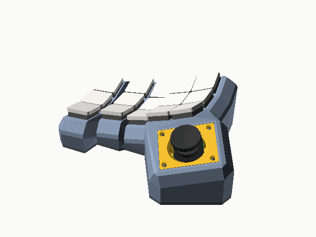

# DIY Analog-WASD Keyboard

> [!CAUTION] **Status: Under Development**  
> A spare-time project, built alongside my bachelor thesis. Progress comes in modest steps.
>
> **Done:** analog stick and Bluetooth connection. **To do:** standard keys, custom key mapping, finished hardware build.
>
> A real keyboard, with pictures and assembly instructions, will follow.
>
> Features and APIs may change. See the [Future Roadmap](#future-roadmap).

## Overview

A keyboard replacement for the left hand that solves "movement finger conflict."
Instead of three fingers for WASD, an **analog stick** handles movement. Your
fingers stay on action keys (E, R, F, Shift, Ctrl).

This keyboard is inspired by the [Charybdis](https://github.com/Bastardkb/Charybdis) split keyboard by Bastard Keyboards. The case layout follows its key well design.

> [!NOTE] **Development Hardware**: Developed and tested on an **ESP32-C3**.



*Demo: the case rendered in OpenSCAD (`cad/body.scad`, rebuild with `make -C cad demo`).*

The ESP32 acts as a Bluetooth Low Energy (BLE) Human Interface Device (HID),
mapping analog stick input to keyboard signals.

- **BLE HID**: Appears as a standard Bluetooth keyboard.
- **Analog Stick Mapping**: A state machine turns analog input into key presses, with deadzone support.
- **Modular**: Bluetooth, hardware abstraction, and application logic are decoupled.
- **Embedded Rust**: Built with `esp-idf-hal` and `esp32-nimble`.

## Setup and Flashing

Prerequisites:

1. **ESP Rust toolchain**: `cargo install espup`, then `espup install`. The project uses the `esp` channel from `rust-toolchain.toml`.
2. **ESP-IDF**: Follow the [esp-idf-template](https://github.com/esp-rs/esp-idf-template) guide for LLVM and the rest of the setup.
3. **espflash**: `cargo install cargo-espflash`.

Connect the ESP32-C3 by USB, then run:

```bash
make firmware                # build
make flash                   # flash the board
make monitor                 # open the serial monitor
make firmware flash monitor  # all three steps
```

## Hardware / 3D Print

The case is parametric in `cad/body.scad` (Charybdis-style key well for Kailh Choc v1,
Hall-effect thumbstick, ESP32-C3 Super Mini). Needs [OpenSCAD](https://openscad.org/).

```bash
make cad                        # macOS app at /Applications/OpenSCAD.app
make cad OPENSCAD=openscad      # Homebrew or any other OpenSCAD on your PATH
```

This writes `case.stl`, `stick_plate.stl`, `stick_carrier.stl`, `knob.stl` and
`bottom.stl` into `cad/`. STLs are not tracked in git. `cad/keyboard.3mf` holds the print settings.

To rebuild the turntable GIF in the Overview, run `make -C cad demo OPENSCAD=openscad` (needs ImageMagick).

Parts: M2 screws, Kailh Choc v1 switches, Hall-effect thumbstick (PS4/PS5 size, ALPS RKJXV footprint).

## Project Structure

- `src/bin/main.rs`: Entry point, initialization, and wiring.
- `src/app.rs`: Main loop and HID report coordination.
- `src/bluetooth.rs`: BLE stack and HID service.
- `src/hardware/`: `mod.rs` (peripheral layer), `analog_stick.rs` (joystick-to-key state machine), `keys.rs` (key input, placeholder), `hardware_bridge_esp32.rs` (ESP32 ADC).
- `src/types.rs`: Shared value types (AdcValue, HidCode).
- `cad/`: `body.scad` (parametric case), `demo.scad` (turntable render), `Makefile` (builds the STLs and the GIF), `keyboard.3mf` (slicer project).
- `docs/`: Pinout, and the turntable demo GIF.
- `Makefile`: Firmware and CAD build targets.

## Configuration

The analog stick deadzone and key mappings are set in `src/hardware/analog_stick.rs`.
For USB HID scan codes, see [USB HID Keyboard Scan Codes](https://gist.github.com/MightyPork/6da26e382a7ad91b5496ee55fdc73db2).

```rust
const DEADZONE: AdcValue = AdcValue(600);
const CENTER: AdcValue = AdcValue(1800);

// Default axis mapping
const Y_AXIS_POSITIVE: HidCode = HidCode(0x1A); // Key W
const X_AXIS_POSITIVE: HidCode = HidCode(0x04); // Key A
const Y_AXIS_NEGATVIE: HidCode = HidCode(0x16); // Key S
const X_AXIS_NEGATVIE: HidCode = HidCode(0x07); // Key D
```

## Future Roadmap

- [ ] **Standard Key Support**: Add support for buttons.
- [ ] **Pictures**: Pictures of a finished keyboard.
- [x] **Case**: 3D-printable case (`cad/`).
- [ ] **Custom Key Mapping**: Implement a way to remap keys.
- [ ] **Platform Portability**: Support for other microcontrollers, if requested, but I can't promise to implement them ;-)
